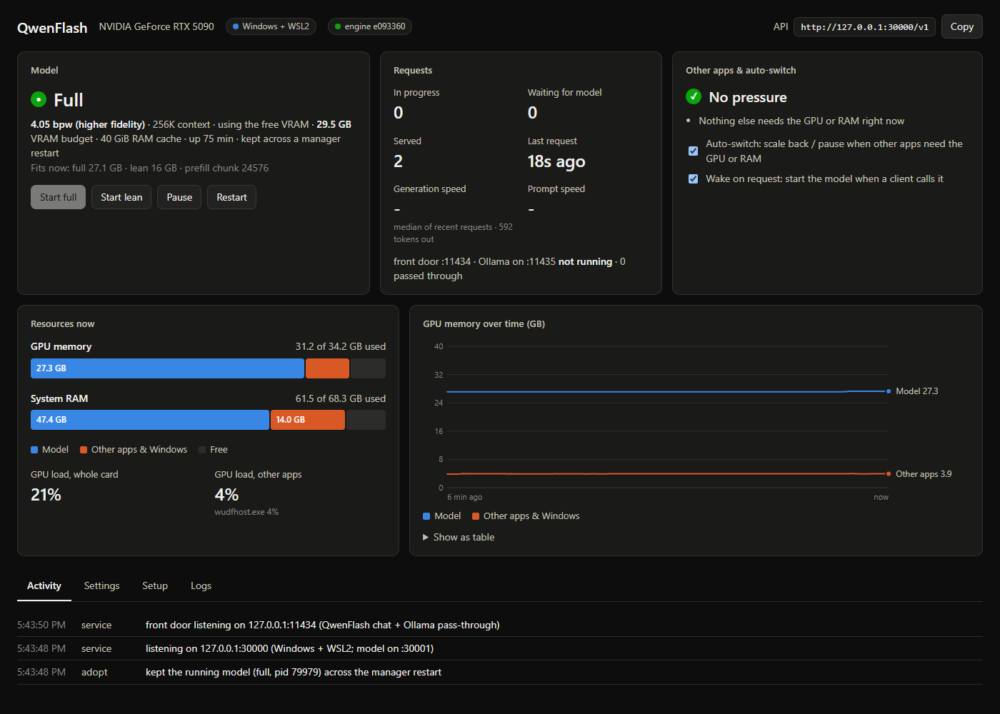
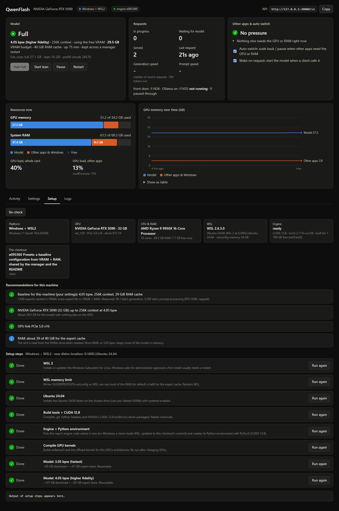
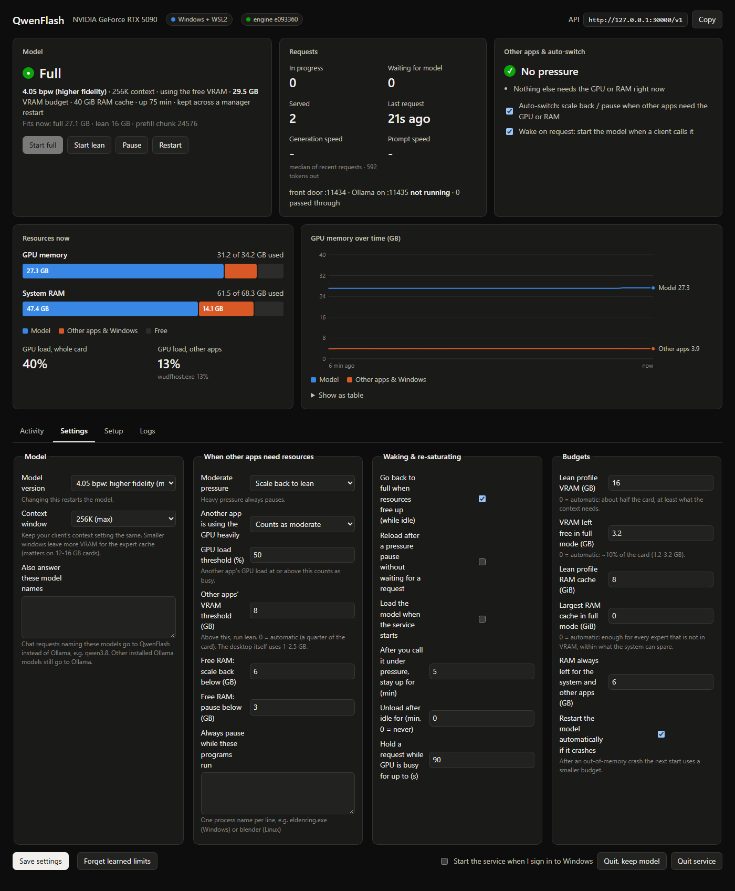

# About this fork

This is [eltorr](https://github.com/eltorr)'s personal fork of
**[MaxDevv/lean-qwenflash](https://github.com/MaxDevv/lean-qwenflash)**. It was forked at upstream commit
[`fa9a772`](https://github.com/MaxDevv/lean-qwenflash/commit/fa9a772d9aa9b94a5653a2c6880eeb97af0d2e9d) (26 Oct 2026).

Upstream is the engine. It streams Qwen3.8-Flash-Next's experts from NVMe, packs the expert store, and serves the
model, so a 125B MoE model runs at full context on a 16 GB card. This fork builds on that engine without replacing
it. It adds:

- a manager with a web dashboard;
- setup for Windows (WSL2) and Linux;
- presets that size the model to the machine;
- a handful of engine fixes found along the way.

It is tuned for my own machine and network, so some defaults and docs are personal; see
[What's personal here](#whats-personal-here).

**For MaxDevv:** anything here is yours to take, adapt or ignore. The engine fixes are small, standalone commits;
see [Taking changes upstream](#taking-changes-upstream).



## Credit

- **[MaxDevv/lean-qwenflash](https://github.com/MaxDevv/lean-qwenflash)**: the engine, the expert store, the
  server, the benchmarks and the original README. Everything this fork does runs on top of it.
- Through upstream:
  - [ExLlamaV3](https://github.com/turboderp-org/exllamav3) by turboderp: quantization format and inference
    runtime. MIT, see `exllamav3/LICENSE`.
  - [glm53-flash-offload](https://github.com/sybil-solutions/glm53-flash-offload) by sybil-solutions: NVMe staging
    and memory tiering. MIT, see `qwen38-flash-offload/LICENSE`.
  - [Qwen3.8-Flash-Next](https://github.com/QwenLM) by the Qwen team.

Upstream has no top-level license file yet, so this fork doesn't add one either. The vendored parts keep their MIT
licenses.

## What's personal here

The fork exists to run this model as a home service on one machine: an RTX 5090 (32 GB), a Ryzen 9 9950X and 64 GB
of RAM, on Windows 11 with the engine in WSL2. There it replaced Ollama. Other devices on my tailnet reach it on
Ollama's port, and its main client is an agent (Hermes Agent). Some of that shows in the defaults and docs:

- The manager's front door takes Ollama's port, 11434. It answers QwenFlash's own model and passes other model names
  through to Ollama, which moves to 11435. If you don't run Ollama, the plain endpoint is
  `http://127.0.0.1:30000/v1`.
- [docs/manager.md](docs/manager.md) has a section on serving a tailnet with `tailscale serve`.
- The model gives the GPU back to games: it scales back or pauses when other apps need the card or the RAM.
- All measurements come from that one machine. Smaller cards were emulated by capping the engine on the 5090, so
  real 8-24 GB cards have less bandwidth and will be slower. See
  [research/vram-scaling/REPORT.md](research/vram-scaling/REPORT.md).

The rest is meant to be general: the sizing and presets, setup for Linux and WSL2, and the engine fixes.

## What it adds



**The manager** ([`qwenflash/`](qwenflash), [docs/manager.md](docs/manager.md)). It is plain Python
(`psutil`, plus `pywin32` on Windows) and never touches the GPU itself.

- **Endpoints:** an OpenAI-compatible endpoint on `127.0.0.1:30000/v1` and an Ollama-style front door.
  [docs/api.md](docs/api.md) describes them.
- **Model lifecycle:**
  - Loads the model when a client calls it.
  - Picks a full or lean profile from the free VRAM and RAM.
  - Scales back or pauses for other GPU apps, and re-saturates when they're done.
  - Restarts it after a crash, and learns lower limits after running out of memory.
  - Grows the RAM cache when RAM frees up.
  - Keeps the model running across its own restarts.
- **Dashboard:** state, speed, GPU/RAM use over time, settings, setup and logs. It is bound to loopback only.
- **Platforms:** [`host.py`](qwenflash/host.py) runs the engine on native Linux, or inside WSL2 from Windows. On
  Windows it measures each app's VRAM through NVML ([`nvml.py`](qwenflash/nvml.py)).

**Setup that detects the platform** ([`setup/`](setup), [`qwenflash/setup.py`](qwenflash/setup.py)):

- **Windows:** installs WSL 2, sets the `.wslconfig` memory limit, and installs Ubuntu 24.04 on a chosen drive.
- **Both platforms:**
  1. build tools + CUDA 12.8;
  2. the engine checkout and its Python environment;
  3. GPU kernels built for the local card;
  4. the 3.05 and 4.05 bpw models.
- Every step runs from the Setup tab or from a terminal (`qwenflash setup STEP`).

**Sizing and presets** ([`sizing.py`](sizing.py)):

- **The VRAM/RAM model:** the fixed footprint, the KV cache per token, the prefill chunk and staging, the expert
  cache slots and the RAM cache. It was calibrated from measured runs.
- **[`run.sh`](run.sh):** starts the server sized for whatever card it finds.
- **[`bin/qwenflash-backend`](bin/qwenflash-backend):** runs the server detached as a transient systemd unit
  (system or `--user`), with raised file and locked-memory limits.
- **Presets:** quant, context, RAM cache and the manager's RAM thresholds from VRAM + RAM + platform. A new install
  starts from the preset, and the dashboard offers it when your settings differ. The README's preset matrix and
  measured table are generated from this code, and a test fails if the README drifts.

**Benchmarks and research** ([`bench/`](bench), [`research/`](research)):

- A VRAM-scaling matrix for 8-32 GB cards (engine capped on the 5090), with raw results and a report.
- The earlier RTX 5090 + WSL2 results.
- [Multi-GPU notes](docs/research/multi-gpu.md).

**Tests** ([`tests/`](tests)): sizing and presets, the manager's config and planning, and the OpenAI request
mapping, alongside upstream's tests.

## Changes to upstream files

Only a few upstream files changed. Everything else is new.

| File | Change |
|---|---|
| `qwen38-flash-offload/qwen38/nv2.py`, `nv_tier.py`, `k_lookahead.py`, `exl3_tiers.py` (+ new `wsl_pinned.py`) | Pinned host memory works under WSL2 (details in the table below). |
| `qwen38-flash-offload/qwen38/expert_cache.py` | A prefill stage holds a whole layer, so 4.05 bpw no longer overflows the 1.1 GiB default. |
| `qwen38-flash-offload/qwen38/serve.py` (+ new `openai_compat.py`) | OpenAI `reasoning_effort` values are mapped onto the template's levels. |
| `qwen_offload.py` | VRAM and torch-allocator limits are configurable; kernels build for the local GPU's architecture instead of 8.9. |
| `memory_guard.py` | Guard limit is configurable; the RAM guard turns off with a message when there is no memory cgroup, instead of crashing. |
| `qwen_server.py` | The prefill chunk can come from `QWEN_CHUNK` (default unchanged, 24576). |
| `download_http.py` | `--branch` and `--sha` fetch other quants (e.g. 4.05 bpw). |
| `.gitignore`, new `.gitattributes` | The allow-list includes the fork's files; files that run inside Linux keep LF endings on Windows checkouts. |
| `README.md` | Fork notice, the QwenFlash section with presets and measurements, requirements, To-Do status. Upstream's text is otherwise kept. |

Every default is unchanged unless the new environment variables are set.

## Taking changes upstream

The first six commits are engine fixes. Each stands on its own and cherry-picks onto upstream `master`:

| Commit | What | Why |
|---|---|---|
| `96decf0` | Keep LF endings for files that run inside Linux (`.gitattributes`) | A Windows checkout used from WSL otherwise gets CRLF shell scripts |
| `851da0e` | `QWEN_VRAM_LIMIT_BYTES`, `QWEN_TORCH_LIMIT_BYTES`, `QWEN_VRAM_GUARD_BYTES` | Cards with more than 16 GB can give the expert cache more room; defaults unchanged |
| `58e8b65` | `cudaHostAlloc` when registered host memory isn't identity-mapped | Needed for WSL2. There `cudaHostRegister` memory gets a different device address, and the kernels dereference raw host addresses. Bare-metal Linux keeps the old path; `QWEN_PINNED_HOSTALLOC=1/0` forces either |
| `4f837dc` | `download_http.py --branch/--sha` | Fetch the 4.05 bpw quant |
| `b0d7045` | Map OpenAI `reasoning_effort` (`minimal/low/medium/high/max/none`) onto the template's `low/medium/xhigh`, and accept `reasoning.effort` | Clients sending `high` got HTTP 500 |
| `b3f6e8d` | Prefill staging sized per layer; `TORCH_CUDA_ARCH_LIST` from the local GPU; RAM guard without a cgroup | The 4.05 bpw first prefill asserted; non-Ada cards built for the wrong architecture; WSL has no memory cgroup at the root |

```bash
git remote add eltorr https://github.com/eltorr/lean-qwenflash.git
git fetch eltorr
git cherry-pick 96decf0 851da0e 58e8b65 4f837dc b0d7045 b3f6e8d
```

The rest builds up in layers, each depending on the one before:

1. `sizing.py` + `run.sh` + `bin/` (`43f16ff`);
2. setup steps (`33d0cef`);
3. the manager (`7529989` and later);
4. benchmarks (`ae91513`, `48757bb`);
5. presets (`e1eb221`).

`sizing.py` and `run.sh` are useful without the manager: `./run.sh server` starts a server sized for the card.

<details>
<summary>All commits on top of upstream</summary>

| Commit | Change |
|---|---|
| `96decf0` | Keep LF line endings for files that run inside Linux |
| `851da0e` | Make the VRAM, torch-allocator and guard limits configurable |
| `58e8b65` | Allocate pinned host memory with cudaHostAlloc when registered memory is not identity-mapped |
| `4f837dc` | download_http: add --branch and --sha to fetch other quants |
| `b0d7045` | Accept OpenAI reasoning_effort levels in the chat endpoint |
| `b3f6e8d` | Size prefill staging per layer, build for the local GPU, tolerate missing cgroups |
| `43f16ff` | Add sizing.py, a hardware-sized launcher (run.sh) and a detached backend runner |
| `33d0cef` | Add setup steps that run on native Linux and inside WSL2 |
| `7529989` | Add the QwenFlash manager: dashboard, OpenAI front door and model lifecycle for Windows+WSL2 and Linux |
| `793701c` | 20_env: check an existing Python environment by its files instead of importing torch |
| `1c148b0` | Keep the detached server alive under WSL; stop retrying a failed start forever |
| `40bf4af` | Run the detached model server as a transient systemd service where available |
| `7a11bb5` | Give the systemd-run server the caller's PATH and HOME; find WSL's nvidia-smi in run.sh |
| `aa91316` | Lift the server unit's open-file and locked-memory limits |
| `da97c77` | Learn the model's real RAM overhead, ignore RAM dips right after a start, keep a manual lean |
| `ae91513` | Add the VRAM scaling benchmark: a CUDA-driver ballast and a matrix runner |
| `d421020` | Docs and launcher for the integrated manager; keep the earlier RTX 5090 results in research/ |
| `373f47f` | Multi-GPU notes: reflect run.sh's GPU pinning and per-GPU builds; matrix: forced staging-free runs |
| `48757bb` | Benchmark smaller cards by capping the engine instead of a ballast; table generator |
| `a681130` | Recalibrate sizing from the VRAM scaling runs; enough prefill reserve on small cards |
| `aad8cf6` | sizing: measured activation size and a fragmentation margin before choosing staging |
| `b8bd081` | VRAM scaling report: 8-32 GB cards; README requirements, numbers and To-Do status |
| `6a1071b` | Grow a full model's RAM cache when RAM frees up |
| `e1eb221` | Presets: a baseline configuration from VRAM + RAM, shared by the manager and the README |

</details>

## Status

- **Windows 11 + WSL2, RTX 5090:** in daily use. Both quants run at 256K context; the 4.05 bpw full profile holds
  every expert in VRAM + RAM.
- **Native Linux:** the manager and dashboard were checked inside WSL, acting as a Linux host. So were setup status,
  first-run presets, and the `systemd --user` backend as a normal user. A model start on a bare-metal Linux box
  hasn't been done yet.
- **Not tested:** real 8-24 GB cards (the numbers come from a capped 5090), Turing (RTX 20) cards, and more RAM with
  less VRAM (e.g. 128 GB with a 24 GB card). That last one is next.
- **Not supported:** two GPUs. The offload layer pins one GPU; see the [notes](docs/research/multi-gpu.md).

## Branches

- `qwenflash` (default): this fork.
- `master`: upstream as it was when forked. To pick up new upstream work:
  `git fetch upstream && git merge upstream/master` on `qwenflash`, after adding upstream as a remote:
  `git remote add upstream https://github.com/MaxDevv/lean-qwenflash.git`.


