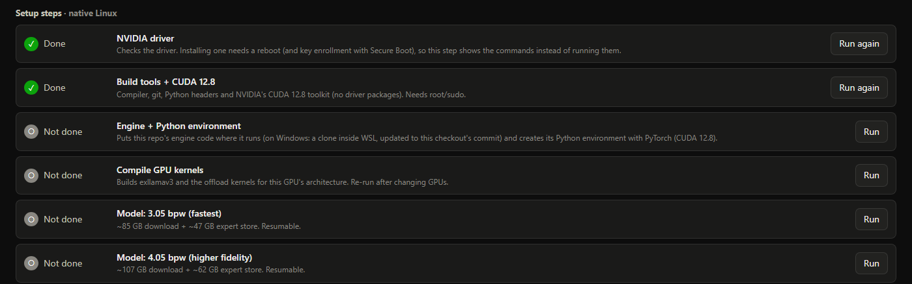

# Lean-QwenFlash (eltorr's fork)

> **This is a personal fork of [MaxDevv/lean-qwenflash](https://github.com/MaxDevv/lean-qwenflash), with
> additions.** The engine is MaxDevv's work. It runs Qwen3.8-Flash-Next, a 125B mixture-of-experts model, at full
> 262K context on a 16 GB card by streaming experts from NVMe. This fork keeps that engine and adds:
>
> - a manager with a web dashboard;
> - setup for Windows (WSL2) and Linux;
> - presets that size the model to the machine;
> - a few engine fixes.
>
> It is tuned for my own setup: an RTX 5090 on Windows 11, serving my home network.
>
> MaxDevv, anything here is yours to take into upstream or to build your own improvements on.


## Differences from the original

| | [Original](https://github.com/MaxDevv/lean-qwenflash) | This fork |
|---|---|---|
| **Engine** | Direct-from-SSD expert offloading, packed expert store, OpenAI server | The same engine, plus fixes:<ul><li>pinned memory under WSL2</li><li>prefill staging sized per layer, so 4.05 bpw works</li><li>configurable VRAM limits</li><li>kernels built for the local GPU</li><li>a RAM guard that works without a memory cgroup</li><li>OpenAI `reasoning_effort` values mapped (`high` gave HTTP 500)</li></ul> |
| **Platforms** | Linux | Linux, and Windows 10/11 (engine in WSL2, manager on Windows) |
| **Cards** | Tuned and measured for 16 GB (RTX 4090 capped, RTX 3080 Laptop) | Sized for 8-48 GB; measured at 8-32 GB (RTX 5090 capped to each size) |
| **Quants** | 3.05 bpw | 3.05 and 4.05 bpw |
| **Settings** | Server flags chosen by hand | Picked by `sizing.py`. Presets set quant, context and RAM cache from VRAM + RAM, and `./run.sh server` starts a server sized to the card |
| **Install** | Manual steps | Setup tab or `qwenflash setup`:<ul><li>Windows: WSL and Ubuntu</li><li>CUDA 12.8 and the Python environment</li><li>kernel build</li><li>model download and packing</li></ul> |
| **Running** | Start `qwen_server.py`; it runs until stopped | A manager service:<ul><li>starts the model on the first request</li><li>scales back or pauses for games and other GPU apps</li><li>restarts after a crash</li><li>keeps the model up across its own restarts</li></ul> |
| **API** | OpenAI Chat Completions on port 30000 (`/v1/chat/completions`, `/v1/completions`, `/v1/models`): streaming, function calling, reasoning levels | The same, plus:<ul><li>the **Responses API** (`/v1/responses`): streaming, function tools, reasoning, `previous_response_id`</li><li>OpenAI `reasoning_effort` values mapped</li><li>loads the model on the first request, queues the rest</li><li>OpenAI-style errors</li></ul>Details: [FORK.md](FORK.md#the-api-whats-original-and-whats-new) |
| **Monitoring** | Terminal output | Local web dashboard (loopback only): state, speed, GPU/RAM over time, settings, setup, logs |
| **Benchmarks** | 4090 / 3080 table | Adds a VRAM-scaling benchmark, a preset matrix by VRAM and RAM, and reports |

[FORK.md](FORK.md) has the full list: every upstream file changed, every commit, and the standalone engine-fix
commits that upstream can cherry-pick. It also covers what is personal to my setup and what is verified.

## Credit

- **[lean-qwenflash](https://github.com/MaxDevv/lean-qwenflash) by MaxDevv** is the engine this fork is built on:
  direct-from-SSD expert offloading, the packed expert store, the OpenAI server, and the original benchmarks and
  documentation. Upstream's README text is kept below, almost unchanged: *About the engine*, MaxDevv's measurements,
  *How It Works*, the manual install, *Serving* and the *To Do* list.
- Through upstream:
  - [ExLlamaV3](https://github.com/turboderp-org/exllamav3) by turboderp;
  - [glm53-flash-offload](https://github.com/sybil-solutions/glm53-flash-offload) by sybil-solutions;
  - [Qwen3.8-Flash-Next](https://github.com/QwenLM) by the Qwen team.

  See [Lineage](#lineage).
- **Licenses:** upstream has no top-level license file yet, so this fork doesn't add one. The bundled ExLlamaV3 and
  offload code keep their MIT licenses.

---

## Quick start

As with the original, you clone the repo, but after that one script and a web page do the rest. You run the
launcher and open the dashboard, and its **Setup** tab finishes the install. It:

- detects the OS (Windows or Linux), the GPU, RAM and drive;
- picks a preset for the machine;
- runs each install step, showing its output.

### 1. What you need

- **OS:**
  - Windows 10/11. The engine runs in WSL2, which setup installs.
  - Or Linux x86_64. The build step automates Ubuntu and Debian; on other distros it lists what to install.
- **GPU:** NVIDIA, Turing (RTX 20) or newer, with 12 GB+ VRAM and a current driver. An 8 GB card works at 16K
  context if it drives no monitor.
- **RAM:** at least 32 GB on Windows or 16 GB on Linux; 64 GB holds the whole model.
- **Disk:** a fast NVMe SSD with about 135 GB free for the 3.05 bpw model, or about 170 GB for 4.05.
- **Software:**
  - Windows: [Git](https://git-scm.com/download/win) and [Python 3](https://www.python.org/downloads/). Tick
    *Add python.exe to PATH* when installing Python.
  - Linux: `sudo apt install git python3-venv`.

### 2. Get it and run the launcher

**Windows** (PowerShell), or double-click `QwenFlash.cmd` in Explorer instead of the last line:

```powershell
git clone https://github.com/eltorr/lean-qwenflash.git
cd lean-qwenflash
.\QwenFlash.cmd
```

**Linux:**

```bash
git clone https://github.com/eltorr/lean-qwenflash.git
cd lean-qwenflash
./qwenflash.sh open
```

The launcher:

1. creates a small Python environment for the manager (`psutil`, plus `pywin32` on Windows);
2. starts the manager in the background;
3. opens the dashboard at **http://127.0.0.1:30000/_switcher/**.

On a Linux server without a desktop, it prints that address instead. Reach it from your PC with
`ssh -L 30000:127.0.0.1:30000 you@server`. The dashboard only listens on the machine itself.

### 3. Finish setup in the dashboard

Open the **Setup** tab. It shows what it detected (platform, GPU, CPU and RAM, plus WSL on Windows, and the engine)
and recommends settings for this machine. The first recommendation is the [preset](#presets-a-baseline-from-vram-and-ram);
click **Apply baseline** if it offers one. Then run the steps from top to bottom. Each step can be run again safely.


| Step | Windows | Linux | What it does |
|---|:---:|:---:|---|
| WSL 2 | ✓ | | Installs WSL. Windows asks for administrator approval, and a first install usually needs a restart; run `QwenFlash.cmd` again afterwards |
| WSL memory limit | ✓ | | Lets WSL use most of the RAM for the expert cache (`.wslconfig`) |
| Ubuntu 24.04 | ✓ | | Installs the distro on the drive you pick; use your fastest NVMe |
| NVIDIA driver | | ✓ | Checks the driver. If it's missing, it shows the install commands, since a driver install needs a reboot |
| Build tools + CUDA 12.8 | ✓ | ✓ | Compiler, Python headers and the CUDA toolkit. Needs sudo on Linux; if the dashboard can't ask for the password, it shows the command to run in a terminal |
| Engine + Python environment | ✓ | ✓ | The engine's Python environment with PyTorch (CUDA 12.8) |
| Compile GPU kernels | ✓ | ✓ | Builds the kernels for your GPU |
| Model: 3.05 or 4.05 bpw | ✓ | ✓ | Downloads the model and packs its expert store: about 85 + 47 GB for 3.05, or 107 + 62 GB for 4.05. Downloads resume after an interruption. The preset says which quant suits the machine |

On Linux, the same tab lists the Linux steps:



You can also run setup from a terminal. `./qwenflash.sh setup` lists the steps, and `./qwenflash.sh setup STEP` runs
one, with STEP one of `wsl`, `wslconfig`, `distro`, `driver`, `base`, `engine`, `build`, `m305` or `m405`. On
Windows, use `.venv\Scripts\python -m qwenflash setup STEP`.

### 4. Use it

The model starts on the first request, or when you click **Start full** in the dashboard. Starting takes a minute or
so. Point any OpenAI-compatible client (Pi, OpenCode, Claude Code, ...) at:

- **Base URL:** `http://127.0.0.1:30000/v1`
- **Model:** `qwen3.8-flash-next`
- **API key:** any non-empty string
- **Context window:** `262144`, or the context the preset picked

Both OpenAI APIs work: Chat Completions (`/v1/chat/completions`) and the newer Responses API (`/v1/responses`). See
[docs/api.md](docs/api.md).

```bash
curl http://127.0.0.1:30000/v1/chat/completions -H "Content-Type: application/json" \
  -d '{"model": "qwen3.8-flash-next", "messages": [{"role": "user", "content": "Hello!"}]}'
```

To start the service when you sign in, tick the box at the bottom of **Settings**. The
[manager guide](docs/manager.md) covers the other options.

Guides: [manager](docs/manager.md) · [API](docs/api.md) · [VRAM scaling results](research/vram-scaling/REPORT.md) ·
[multi-GPU notes](docs/research/multi-gpu.md).

---

## About the engine

*From the original README.*

**Qwen3.8-Flash-Next at full 262k context on 8 GB RAM and 16 GB VRAM—20 tok/s generation and 1,600 tok/s prefill.**


*Inference run on an RTX 4090, capped at 16 GB VRAM and 8 GB system RAM.*

Direct-from-SSD expert offloading for **Qwen3.8-Flash-Next** (125B MoE, 512 experts).

Most setups for this model require 48–64 GB of system RAM just to hold the expert weights in memory. This runtime streams uncached experts directly from NVMe storage over PCIe into a bounded GPU cache via `O_DIRECT`, while streaming the 51B N-gram embedding table from disk. All expert computation runs on the GPU.

Built on [ExLlamaV3](https://github.com/turboderp-org/exllamav3) and adapted from the [glm53-flash-offload](https://github.com/sybil-solutions/glm53-flash-offload) engine.

---

## Presets: a baseline from VRAM and RAM

The manager starts from a preset for the card, the RAM and the platform. A preset sets:

- the quant;
- the context window;
- the RAM cache;
- the manager's own RAM thresholds.

A new install applies it. Later, the dashboard offers it as a recommendation when your settings differ.
`./qwenflash.sh plan` shows your machine's preset; `python3 sizing.py baseline --vram-gb 24 --ram-gb 128` shows any
machine's.

The table is for Linux, with the card also driving the desktop (except where the 8 GB rows say otherwise). Each
cell gives:

1. quant · context;
2. the RAM cache, and how much of the model it keeps in memory (VRAM + RAM);
3. whether that configuration has been tested:
   - ✅ **tested:** that exact configuration was measured (card size, quant, context, prefill mode, and a RAM
     cache holding as much of the model). The cell gives the generation speed and the hardware. "64 GB RAM" in a
     128 GB column means the run had 64 GB, with the same configuration, since every expert was already in memory.
   - ⚪ **not tested:** computed by [`sizing.py`](sizing.py) only.

<!-- presets:begin -->
| Card (VRAM) | 16 GB RAM | 32 GB RAM | 64 GB RAM | 128 GB RAM |
|---|---|---|---|---|
| **8 GB, no display** | **3.05** · 16K, no staging<br>4 GiB RAM cache, 10% in memory<br>⚪ not tested | **3.05** · 16K, no staging<br>15 GiB RAM cache, 36% in memory<br>⚪ not tested | **3.05** · 16K, no staging<br>42 GiB RAM cache, all in memory<br>✅ *20.2 tok/s* · RTX 5090 capped to 8 GB | **3.05** · 16K, no staging<br>42 GiB RAM cache, all in memory<br>✅ *20.2 tok/s* · RTX 5090 capped to 8 GB, 64 GB RAM |
| **8 GB, with display** | not enough VRAM | not enough VRAM | not enough VRAM | not enough VRAM |
| **12 GB** | **3.05** · 64K, no staging<br>4 GiB RAM cache, 15% in memory<br>⚪ not tested | **3.05** · 64K, no staging<br>15 GiB RAM cache, 41% in memory<br>⚪ not tested | **3.05** · 64K, no staging<br>40 GiB RAM cache, all in memory<br>⚪ not tested | **3.05** · 64K, no staging<br>40 GiB RAM cache, all in memory<br>⚪ not tested |
| **16 GB** | **3.05** · 256K<br>4 GiB RAM cache, 18% in memory<br>⚪ not tested | **3.05** · 256K<br>15 GiB RAM cache, 44% in memory<br>⚪ not tested | **3.05** · 256K<br>39 GiB RAM cache, all in memory<br>✅ *37.8 tok/s* · RTX 5090 capped to 16 GB | **3.05** · 256K<br>39 GiB RAM cache, all in memory<br>✅ *37.8 tok/s* · RTX 5090 capped to 16 GB, 64 GB RAM |
| **24 GB** | **3.05** · 256K<br>4 GiB RAM cache, 34% in memory<br>⚪ not tested | **3.05** · 256K<br>15 GiB RAM cache, 60% in memory<br>⚪ not tested | **4.05** · 256K<br>45 GiB RAM cache, all in memory<br>✅ *42.6 tok/s* · RTX 5090 capped to 24 GB | **4.05** · 256K<br>47 GiB RAM cache, all in memory<br>✅ *42.6 tok/s* · RTX 5090 capped to 24 GB, 64 GB RAM |
| **32 GB** | **3.05** · 256K<br>4 GiB RAM cache, 51% in memory<br>⚪ not tested | **3.05** · 256K<br>15 GiB RAM cache, 77% in memory<br>⚪ not tested | **4.05** · 256K<br>40 GiB RAM cache, all in memory<br>✅ *51.0 tok/s* · RTX 5090 | **4.05** · 256K<br>40 GiB RAM cache, all in memory<br>✅ *51.0 tok/s* · RTX 5090, 64 GB RAM |
| **48 GB** | **3.05** · 256K<br>4 GiB RAM cache, 89% in memory<br>⚪ not tested | **3.05** · 256K<br>9 GiB RAM cache, all in memory<br>⚪ not tested | **4.05** · 256K<br>24 GiB RAM cache, all in memory<br>⚪ not tested | **4.05** · 256K<br>24 GiB RAM cache, all in memory<br>⚪ not tested |
<!-- presets:end -->

- **Quant:** 4.05 bpw (higher fidelity) where it keeps 256K context, full-speed prompt processing and nearly every
  expert in VRAM or RAM. Otherwise 3.05 bpw: its experts are 25% smaller, so it is faster at every card size.
- **Context:** the largest that keeps staged prefill. 12 GB cards get 64K without staging (agents need the window
  more than the faster prefill); 8 GB cards get 16K without staging, and only when the card drives no display.
- **RAM:** the RAM cache holds every expert that isn't in VRAM, as far as RAM allows; the rest is read from the NVMe
  drive when picked. Experts are picked very unevenly, so the share of *picks* served from memory is far higher
  than the share of experts held (a 16 GB card's 2,400 cached experts served 66% of picks). On 16-32 GB machines the
  manager's RAM thresholds scale down with the RAM.
- **Windows** keeps about 8 GB more for itself and WSL: 16 GB of RAM is too little there, and 32-64 GB machines get
  smaller RAM caches (`python3 sizing.py presets --platform windows-wsl`).

---

## Tested so far

### Platforms and features

| | Status | Notes |
|---|---|---|
| Windows 11 + WSL2, RTX 5090, 64 GB RAM | ✅ In daily use | Both quants at 256K context. Manager, dashboard, setup steps and auto-switch |
| OpenAI API: Chat Completions and Responses | ✅ Tested | End to end with the official `openai` Python SDK on this PC: chat (plain, streamed, tools) and Responses (plain, streamed, a tool round trip, `previous_response_id`) |
| Native Linux | 🟡 Partly | Checked inside WSL acting as a Linux host: the manager, dashboard, setup status, first-run preset, and the `systemd --user` backend as a normal user. No model has been started on a bare-metal Linux box yet |
| Setup on a clean machine | ⚪ Not yet | The steps have run on this PC. A clean Windows or Linux install hasn't been tried |
| Real 8-24 GB cards | ⚪ Not yet | The numbers below come from the RTX 5090 capped to each card size |
| Turing (RTX 20) cards | ⚪ Not yet | |
| 16-32 GB or 128 GB of RAM | ⚪ Not yet | The presets are computed. Next up: 128 GB with a 24 GB card or smaller |
| Two GPUs | ❌ Not supported | See the [notes](docs/research/multi-gpu.md) |
| The original's results (RTX 4090, RTX 3080 Laptop) | ✅ By MaxDevv | [Below](#original-measured-by-maxdevv), unchanged |

### This fork: RTX 5090

All on the machine this fork was built on: an RTX 5090 (PCIe 5.0), a Ryzen 9 9950X and 64 GB of RAM, on Windows 11
+ WSL2.

- **Full-card rows** use the whole card.
- **Capped rows** hold the engine to a smaller card's VRAM. That only emulates capacity: real smaller cards also have
  less bandwidth and slower PCIe, so expect less from them.
- **Compare within one report:** the two reports measure decode a little differently.
- **Adding results:** new results go into `sizing.MEASURED`, and `python3 sizing.py presets --write README.md`
  regenerates this table and the preset matrix.

<!-- measured:begin -->
| Card (VRAM) | Quant | Context | RAM cache | Prefill | Decode | Measured on | Details |
|---|---|---|---|---|---|---|---|
| **32 GB** | 3.05 | 256K | 26 GiB | 6,407 tok/s | 60.8 tok/s | RTX 5090, 64 GB RAM, Windows (WSL2) | [report](research/rtx5090-wsl/REPORT.md) |
| **32 GB** | 3.05 | 256K | 25 GiB | 5,754 tok/s | 64.0 tok/s | RTX 5090 capped to 32 GB, 64 GB RAM, Windows (WSL2) | [report](research/vram-scaling/REPORT.md) |
| **24 GB** | 3.05 | 256K | 32 GiB | 5,896 tok/s | 51.5 tok/s | RTX 5090 capped to 24 GB, 64 GB RAM, Windows (WSL2) | [report](research/vram-scaling/REPORT.md) |
| **16 GB** | 3.05 | 256K | 38 GiB | 4,338 tok/s | 37.8 tok/s | RTX 5090 capped to 16 GB, 64 GB RAM, Windows (WSL2) | [report](research/vram-scaling/REPORT.md) |
| **12 GB** | 3.05 | 64K | 38 GiB | 1,816 tok/s | 33.2 tok/s | RTX 5090 capped to 12 GB, 64 GB RAM, Windows (WSL2) | [report](research/vram-scaling/REPORT.md) |
| **12 GB** | 3.05 | 128K, no staging | 38 GiB | 1,564 tok/s | 29.9 tok/s | RTX 5090 capped to 12 GB, 64 GB RAM, Windows (WSL2) | [report](research/vram-scaling/REPORT.md) |
| **8 GB, no display** | 3.05 | 16K, no staging | 38 GiB | 1,166 tok/s | 20.2 tok/s | RTX 5090 capped to 8 GB, 64 GB RAM, Windows (WSL2) | [report](research/vram-scaling/REPORT.md) |
| **32 GB** | 4.05 | 256K | 34 GiB | 5,732 tok/s | 56.3 tok/s | RTX 5090, 64 GB RAM, Windows (WSL2) | [report](research/rtx5090-wsl/REPORT.md) |
| **32 GB** | 4.05 | 256K | 40 GiB | 6,326 tok/s | 51.0 tok/s | RTX 5090, 64 GB RAM, Windows (WSL2) | [report](research/rtx5090-wsl/REPORT.md) |
| **32 GB** | 4.05 | 256K | 38 GiB | 5,293 tok/s | 56.1 tok/s | RTX 5090 capped to 32 GB, 64 GB RAM, Windows (WSL2) | [report](research/vram-scaling/REPORT.md) |
| **24 GB** | 4.05 | 256K | 38 GiB | 5,006 tok/s | 42.6 tok/s | RTX 5090 capped to 24 GB, 64 GB RAM, Windows (WSL2) | [report](research/vram-scaling/REPORT.md) |
| **16 GB** | 4.05 | 256K | 38 GiB | 1,384 tok/s | 30.3 tok/s | RTX 5090 capped to 16 GB, 64 GB RAM, Windows (WSL2) | [report](research/vram-scaling/REPORT.md) |
| **12 GB** | 4.05 | 32K, no staging | 38 GiB | 431 tok/s | 26.6 tok/s | RTX 5090 capped to 12 GB, 64 GB RAM, Windows (WSL2) | [report](research/vram-scaling/REPORT.md) |
<!-- measured:end -->

### Original: measured by MaxDevv

From the original README, unchanged. Benchmarked using `turboderp/Qwen3.8-Flash-Next-exl3` (`3.05bpw_h5_ng5`) with 4-bit KV cache unless noted:

| Hardware | Context | System RAM Used | VRAM Used | Prefill | Decode |
| :--- | :--- | :--- | :--- | :--- | :--- |
| **RTX 4090** | 8k | ~8 GB | <16 GB | 1,080 tok/s | 28–33 tok/s (prose)<br>19–22 tok/s (code) |
| **RTX 4090** | 100k | ~8 GB | 15.6 GB | 1,536 tok/s | 20.8 tok/s |
| **RTX 4090** | 262k | ~8 GB | 15.6 GB | 1,627 tok/s | 20.0 tok/s |
| **RTX 3080 Laptop (16GB)** | 100k (8 GB cache) | 19.0 GB | 15.5 GB | 647 tok/s | 17.6 tok/s |
| **RTX 3080 Laptop (16GB)** | 100k (16 GB cache) | 23.9 GB | 15.5 GB | 693 tok/s | 20.9 tok/s |
| **RTX 4090** | 17 tokens (4 GB cache, unquantized KV) | 8.55 GB | 14.90 GB | — | 16.0 tok/s (code) |

---

## How It Works

Qwen3.8-Flash-Next activates only 10 of its 512 experts per layer per token (~2% of weights).

* **GPU (16 GB VRAM):** Dense attention mixers, DeltaNet state, routers, shared experts, output head, 4-bit KV cache, and an adaptive GPU expert cache.
* **Host RAM:** Configurable cache (4–16 GB) holding the most recently activated experts.
* **NVMe Storage:** The full ~47 GB packed expert store and 32 GB N-gram table sit on SSD. Cache misses are read directly via asynchronous ring buffers and staged ahead of the compute stream.
* **GPU-Only Math:** All expert computation stays on the GPU. Misses stream over PCIe rather than falling back to CPU execution, avoiding host DRAM bandwidth limits.
* **Prefix Caching:** Recurrent state checkpoints are saved alongside the KV cache so multi-turn agent requests start decoding immediately (~0.8s–1.4s TTFT on cached follow-ups).

---

## Manual install (the original instructions)

Without the manager, as in the original README. The [Quick start](#quick-start) above does all of this for you.

### 1. Requirements
* Linux (x86_64), or Windows 10/11 with the engine in WSL2 (the [manager](docs/manager.md) sets that up)
* NVIDIA GPU, Turing or newer, with at least 12 GB VRAM (16 GB+ recommended). An 8 GB card works at 16k context if
  it doesn't also drive a display ([measurements](research/vram-scaling/REPORT.md))
* RAM: 16 GB on Linux and 32 GB on Windows at minimum; 64 GB keeps the whole model in VRAM + RAM
  ([presets](#presets-a-baseline-from-vram-and-ram))
* Fast NVMe SSD (PCIe 3.0 or 4.0, ~3+ GB/s read throughput)
* CUDA 12.4+ (12.8 for RTX 50 cards) and Python 3.10–3.12

`./run.sh server` starts the server sized from the hardware, without the manager.

### 2. Install

```bash
git clone https://github.com/eltorr/lean-qwenflash.git   # this fork; upstream: MaxDevv/lean-qwenflash
cd lean-qwenflash

python3 -m venv .venv
source .venv/bin/activate
pip install torch --index-url https://download.pytorch.org/whl/cu128
pip install fastapi uvicorn safetensors jinja2 huggingface_hub
pip install -e exllamav3
```

Compile the native offload extensions:
```bash
python compile_local.py
```

### 3. Download & Build Store

Download the 3.05bpw checkpoint and N-gram table (~85 GB total):
```bash
python download_http.py --model-dir ./model
```

Pack the routed experts into a direct-I/O binary store (~47 GB):
```bash
mkdir -p ./store
python qwen38-flash-offload/scripts/pack_qwen38_store.py pack \
  --model ./model \
  --out-dir ./store \
  --name qwen
```

---

## Serving

Start the OpenAI-compatible server on port `30000`:

```bash
python qwen_server.py \
  --model ./model \
  --store ./store/qwen.bin \
  --ram-gb 8 \
  --cache 262144 \
  --chunk 24576 \
  --port 30000
```

### Agent Configuration
Point tools like Pi, OpenCode, or Claude Code to:
* **Base URL:** `http://127.0.0.1:30000/v1`
* **Model:** `qwen3.8-flash-next`
* **Context Window:** `262144`

Supports streaming, reasoning effort control (`off`, `low`, `medium`, `xhigh`), and OpenAI function calling.

### CLI Test
To run a one-shot generation from the terminal:

```bash
python infer.py \
  --model ./model \
  --store ./store/qwen.bin \
  --ram-gb 4 \
  --prompt "Write an implementation of merge sort in C."
```

---

## To Do

If I get some free time—or someone wants to contribute or put an agent on it:

- ~~**Lower VRAM:** Adapt and benchmark on 12 GB, and potentially 8 GB GPUs.~~
  - **Done in this fork:** `sizing.py` sizes the cache, prefill chunk, staging and reserve for the card. 12 GB runs
    3.05 bpw up to 128k context and 4.05 at 32k. 8 GB runs 3.05 at 16k when the card has no display attached.
    Measured with the engine capped on an RTX 5090 ([report](research/vram-scaling/REPORT.md)).
  - **Still open:** real 8-12 GB cards; an 8 GB card that also drives a desktop. For the latter, shrink the ~6.2 GB
    fixed footprint first (≈2.5 GB of it is not yet attributed; per-expert scales could move into the expert
    records).
- ~~**Higher VRAM:** Benchmark 24 GB and 32 GB GPUs.~~ **Done:** decode 51.5 / 64 tok/s (3.05) at 24 / 32 GB; prefill
  stays ~5,800 tok/s ([report](research/vram-scaling/REPORT.md)).
- **Presets, next measurements:** more RAM with less VRAM (128 GB with a 24 GB card and smaller), 16-32 GB of RAM,
  and real 8-24 GB cards. `bench/vram_matrix.py` runs them (`:ram=N` sets the RAM cache) and
  `bench/vram_table.py --sizing` prints the rows for `sizing.MEASURED`.
- **Prefill on 12-16 GB cards:** a single staging buffer, to keep big chunks where two don't fit.
- **Two GPUs:** not supported by the offload layer yet. A layer split looks like the best fit
  ([research notes](docs/research/multi-gpu.md)).

---

## Lineage

* [lean-qwenflash](https://github.com/MaxDevv/lean-qwenflash) by MaxDevv: the upstream of this fork (the engine,
  expert store and server). This fork's additions are listed in [FORK.md](FORK.md).
* [ExLlamaV3](https://github.com/turboderp-org/exllamav3) by turboderp (quantization format & inference runtime).
* [glm53-flash-offload](https://github.com/sybil-solutions/glm53-flash-offload) by sybil-solutions (NVMe staging & memory tiering architecture).
* [Qwen3.8-Flash-Next](https://github.com/QwenLM) by Alibaba Cloud Qwen team.
