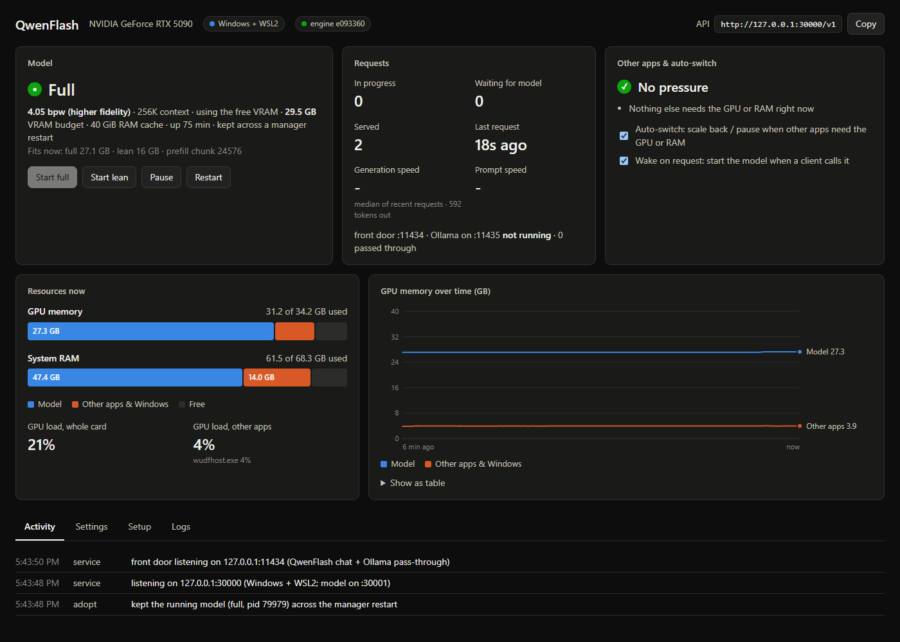
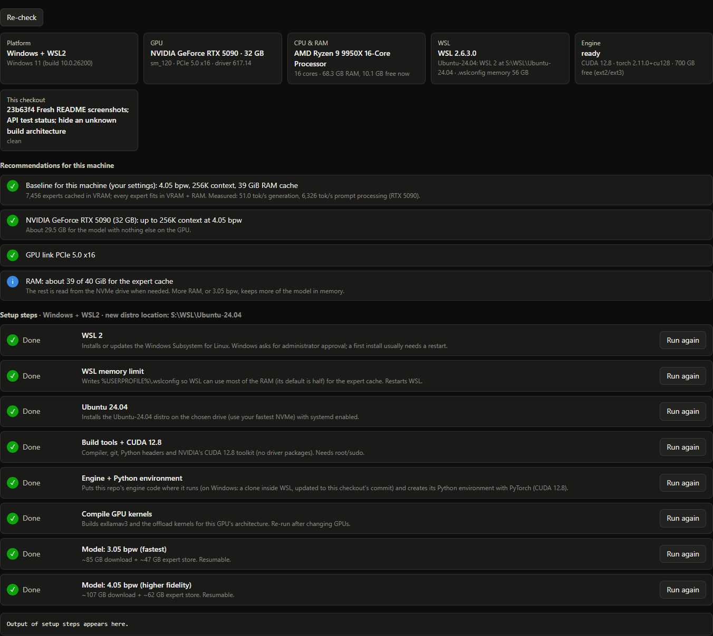

# Lean-QwenFlash (eltorr's fork)

A personal fork of **[MaxDevv/lean-qwenflash](https://github.com/MaxDevv/lean-qwenflash)**. The engine is
MaxDevv's: it runs Qwen3.8-Flash-Next, a 125B mixture-of-experts model, at full 262K context on a 16 GB card by
streaming experts from NVMe.

This fork started because my AI machine is also my gaming PC, and I wanted the model's resources to adapt. When a
game needs the GPU or RAM, the model scales itself back or pauses. When the game closes, the model takes the
resources back. The fork also adds a dashboard, guided setup on Windows and Linux, and presets that size the model
to the machine.

Clone it and make it your own. Just keep the credit to MaxDevv, whose engine it's built on ([Credit](#credit)).



## Differences from the original

| | [Original](https://github.com/MaxDevv/lean-qwenflash) | This fork |
|---|---|---|
| **Running** | Start `qwen_server.py` by hand | A service: loads on the first request, scales back or pauses for games, restarts after a crash |
| **Setup** | Manual steps, Linux | A Setup tab on Windows (WSL2) and Linux that detects the machine and runs each step |
| **Sizing** | Flags set by hand, tuned for 16 GB | Presets pick the quant, context and RAM cache for 8-48 GB cards; short prompts skip prefill staging, so a 1-2K-token prompt starts in 1.4-2.6 s instead of 6-7 |
| **Quants** | 3.05 bpw | 3.05 and 4.05 bpw |
| **API** | OpenAI Chat Completions | Adds the OpenAI Responses API ([what's new](FORK.md#api-whats-original-and-whats-new)) |
| **Monitoring** | Terminal output | A local web dashboard |
| **Benchmarks** | `benchmark.py`, started by hand | A Benchmark tab and `qwenflash bench`: any configuration, with the stack recorded and compared with the last run ([records](research/README.md)) |
| **Engine** | | A few fixes: pinned memory under WSL2, VRAM limits that count what CUDA can't see under WSL2, 4.05 bpw prefill, configurable VRAM limits, kernels built for the local GPU, OpenAI `reasoning_effort` values |
| **Stack** | PyTorch 2.11, CUDA 12.8 | PyTorch 2.15, CUDA 13.2: prefill 47-72% faster, decode the same ([report](research/torch-2.15/REPORT.md)) |
| **Security** | Listens on localhost | A sign-in token for the dashboard, other websites refused, a model server only the manager can call, packages pinned by hash, verified downloads |
| **Checks** | | Lint, shellcheck, secret and CVE scans and unit tests, locally and on every push |

[FORK.md](FORK.md) lists the changes, including the engine fixes upstream can cherry-pick.
[CHANGELOG.md](CHANGELOG.md) lists them by date.

## Quick start

**You need:** an NVIDIA GPU (RTX 20 or newer, 12 GB+) with driver 595 or newer, 32 GB of RAM (16 GB on Linux), a
fast NVMe SSD with about 170 GB free, and Git and Python 3. On Windows, tick *Add python.exe to PATH* when installing
Python. On Linux, setup automates Ubuntu 22.04+ and Debian 12+.

**Windows:**

```powershell
git clone https://github.com/eltorr/lean-qwenflash.git
cd lean-qwenflash
.\QwenFlash.cmd
```

**Linux:**

```bash
git clone https://github.com/eltorr/lean-qwenflash.git
cd lean-qwenflash
./qwenflash.sh open
```

The dashboard opens at http://127.0.0.1:30000, the same port as the API. To open it again later, run the same
command; it signs the browser in. In its **Setup** tab:

1. It detects the OS, GPU, RAM and drive, and recommends a preset. Click **Apply baseline**.
2. Run the steps from top to bottom. Each can be run again safely.



Then point any OpenAI-compatible client at `http://127.0.0.1:30000/v1`, with model `qwen3.8-flash-next` and any
API key. The model loads on the first request, which takes about a minute.

More: [manager guide](docs/manager.md) · [API](docs/api.md)

## Presets

The manager starts from a preset for the card and the RAM. To see yours, run `./qwenflash.sh plan`.

- **✅** measured, with the generation speed;
- **⚪** computed by [`sizing.py`](sizing.py), not tested yet.

The figures are for Linux; Windows keeps about 8 GB more RAM for itself.

<!-- presets:begin -->
| Card (VRAM) | 16 GB RAM | 32 GB RAM | 64 GB RAM | 128 GB RAM |
|---|---|---|---|---|
| **8 GB, no display** | **3.05** · 16K, no staging<br>4 GiB RAM cache, 10% in memory<br>⚪ not tested | **3.05** · 16K, no staging<br>15 GiB RAM cache, 36% in memory<br>⚪ not tested | **3.05** · 16K, no staging<br>38 GiB RAM cache, 91% in memory<br>✅ *26.4 tok/s* · RTX 5090 capped to 8 GB | **3.05** · 16K, no staging<br>38 GiB RAM cache, 91% in memory<br>✅ *26.4 tok/s* · RTX 5090 capped to 8 GB, 64 GB RAM |
| **8 GB, with display** | not enough VRAM | not enough VRAM | not enough VRAM | not enough VRAM |
| **12 GB** | **3.05** · 64K, no staging<br>4 GiB RAM cache, 15% in memory<br>⚪ not tested | **3.05** · 64K, no staging<br>15 GiB RAM cache, 41% in memory<br>⚪ not tested | **3.05** · 64K, no staging<br>36 GiB RAM cache, 91% in memory<br>⚪ not tested | **3.05** · 64K, no staging<br>36 GiB RAM cache, 91% in memory<br>⚪ not tested |
| **16 GB** | **3.05** · 256K<br>4 GiB RAM cache, 18% in memory<br>⚪ not tested | **3.05** · 256K<br>15 GiB RAM cache, 44% in memory<br>⚪ not tested | **3.05** · 256K<br>35 GiB RAM cache, 92% in memory<br>✅ *41.9 tok/s* · RTX 5090 capped to 16 GB | **3.05** · 256K<br>35 GiB RAM cache, 92% in memory<br>✅ *41.9 tok/s* · RTX 5090 capped to 16 GB, 64 GB RAM |
| **24 GB** | **3.05** · 256K<br>4 GiB RAM cache, 35% in memory<br>⚪ not tested | **3.05** · 256K<br>15 GiB RAM cache, 61% in memory<br>⚪ not tested | **4.05** · 256K<br>41 GiB RAM cache, 91% in memory<br>✅ *51.4 tok/s* · RTX 5090 capped to 24 GB | **4.05** · 256K<br>41 GiB RAM cache, 91% in memory<br>✅ *51.4 tok/s* · RTX 5090 capped to 24 GB, 64 GB RAM |
| **32 GB** | **3.05** · 256K<br>4 GiB RAM cache, 53% in memory<br>⚪ not tested | **3.05** · 256K<br>15 GiB RAM cache, 79% in memory<br>⚪ not tested | **4.05** · 256K<br>33 GiB RAM cache, 90% in memory<br>✅ *59.7 tok/s* · RTX 5090 | **4.05** · 256K<br>33 GiB RAM cache, 90% in memory<br>✅ *59.7 tok/s* · RTX 5090, 64 GB RAM |
| **48 GB** | **3.05** · 256K<br>4 GiB RAM cache, 90% in memory<br>⚪ not tested | **3.05** · 256K<br>6 GiB RAM cache, 95% in memory<br>⚪ not tested | **4.05** · 256K<br>17 GiB RAM cache, 90% in memory<br>⚪ not tested | **4.05** · 256K<br>17 GiB RAM cache, 90% in memory<br>⚪ not tested |
<!-- presets:end -->

## Tested so far

- ✅ **Windows 11 + WSL2, RTX 5090, 64 GB RAM:** in daily use with both quants at 256K. This covers the manager,
  dashboard, setup and auto-switch.
- ✅ **OpenAI API:** Chat Completions and Responses, tested end to end with the official `openai` SDK.
- 🟡 **Native Linux:** the manager, dashboard and setup were checked; no model has run on a bare-metal Linux machine
  yet.
- ⚪ **Not yet:**
  - a clean-machine install;
  - real 8-24 GB cards (the rows below emulate them on the 5090);
  - RTX 20 cards;
  - 16-32 GB or 128 GB of RAM.
- ❌ **Two GPUs:** not supported ([notes](docs/research/multi-gpu.md)).

### This fork: RTX 5090

"Capped" rows hold the engine to a smaller card's VRAM. Real smaller cards also have less bandwidth, so expect less
from them. Measured on PyTorch 2.15 and CUDA 13.2, the way the original's `benchmark.py` measures: short answers with
thinking off for decode, and a document of up to 100K tokens for prefill ([report](research/vram-scaling-torch-2.15/REPORT.md)).
The 4.05 bpw whole-card row with a 34 GiB RAM cache (this PC's own setup) was measured on 2026-11-06, after short
prompts started skipping staging. The other rows were measured the day before, so their prefill figures are low: on
that row, 100K tokens went from 4,364 to 5,312 tok/s, 8K from 1,129 to 2,546, and a 1-2K-token prompt now gets its
first token in 1.4-2.6 s instead of 6-7.

<!-- measured:begin -->
| Card (VRAM) | Quant | Context | RAM cache | Prefill | Decode | Measured on |
|---|---|---|---|---|---|---|
| **32 GB** | 3.05 | 256K | 26 GiB | 4,668 tok/s | 72.1 tok/s | [RTX 5090](research/vram-scaling-torch-2.15/REPORT.md), 64 GB RAM, Windows (WSL2) |
| **32 GB** | 3.05 | 256K | 38 GiB | 4,722 tok/s | 74.4 tok/s | [RTX 5090 capped to 32 GB](research/vram-scaling-torch-2.15/REPORT.md), 64 GB RAM, Windows (WSL2) |
| **24 GB** | 3.05 | 256K | 38 GiB | 4,628 tok/s | 62.5 tok/s | [RTX 5090 capped to 24 GB](research/vram-scaling-torch-2.15/REPORT.md), 64 GB RAM, Windows (WSL2) |
| **16 GB** | 3.05 | 256K | 38 GiB | 2,684 tok/s | 41.9 tok/s | [RTX 5090 capped to 16 GB](research/vram-scaling-torch-2.15/REPORT.md), 64 GB RAM, Windows (WSL2) |
| **12 GB** | 3.05 | 64K | 38 GiB | 688 tok/s | 36.1 tok/s | [RTX 5090 capped to 12 GB](research/vram-scaling-torch-2.15/REPORT.md), 64 GB RAM, Windows (WSL2) |
| **12 GB** | 3.05 | 128K, no staging | 38 GiB | 1,933 tok/s | 34.4 tok/s | [RTX 5090 capped to 12 GB](research/vram-scaling-torch-2.15/REPORT.md), 64 GB RAM, Windows (WSL2) |
| **8 GB, no display** | 3.05 | 16K, no staging | 38 GiB | 1,490 tok/s | 26.4 tok/s | [RTX 5090 capped to 8 GB](research/vram-scaling-torch-2.15/REPORT.md), 64 GB RAM, Windows (WSL2) |
| **8 GB, with display** | 3.05 | 16K, no staging | 38 GiB | 1,637 tok/s | 20.3 tok/s | [RTX 5090 capped to 8 GB](research/vram-scaling-torch-2.15/REPORT.md), 64 GB RAM, Windows (WSL2) |
| **32 GB** | 4.05 | 256K | 34 GiB | 5,312 tok/s | 59.7 tok/s | [RTX 5090](research/vram-scaling-torch-2.15/REPORT.md), 64 GB RAM, Windows (WSL2) |
| **32 GB** | 4.05 | 256K | 40 GiB | 4,233 tok/s | 61.0 tok/s | [RTX 5090](research/vram-scaling-torch-2.15/REPORT.md), 64 GB RAM, Windows (WSL2) |
| **32 GB** | 4.05 | 256K | 38 GiB | 4,296 tok/s | 63.0 tok/s | [RTX 5090 capped to 32 GB](research/vram-scaling-torch-2.15/REPORT.md), 64 GB RAM, Windows (WSL2) |
| **24 GB** | 4.05 | 256K | 38 GiB | 4,252 tok/s | 51.4 tok/s | [RTX 5090 capped to 24 GB](research/vram-scaling-torch-2.15/REPORT.md), 64 GB RAM, Windows (WSL2) |
| **16 GB** | 4.05 | 256K | 38 GiB | 1,183 tok/s | 34.5 tok/s | [RTX 5090 capped to 16 GB](research/vram-scaling-torch-2.15/REPORT.md), 64 GB RAM, Windows (WSL2) |
| **12 GB** | 4.05 | 32K, no staging | 38 GiB | 1,104 tok/s | 29.6 tok/s | [RTX 5090 capped to 12 GB](research/vram-scaling-torch-2.15/REPORT.md), 64 GB RAM, Windows (WSL2) |
<!-- measured:end -->

### The original: measured by MaxDevv

From the original README. Benchmarked using `turboderp/Qwen3.8-Flash-Next-exl3` (`3.05bpw_h5_ng5`) with a 4-bit KV
cache unless noted:

| Hardware | Context | System RAM Used | VRAM Used | Prefill | Decode |
| :--- | :--- | :--- | :--- | :--- | :--- |
| **RTX 4090** | 8k | ~8 GB | <16 GB | 1,080 tok/s | 28–33 tok/s (prose)<br>19–22 tok/s (code) |
| **RTX 4090** | 100k | ~8 GB | 15.6 GB | 1,536 tok/s | 20.8 tok/s |
| **RTX 4090** | 262k | ~8 GB | 15.6 GB | 1,627 tok/s | 20.0 tok/s |
| **RTX 3080 Laptop (16GB)** | 100k (8 GB cache) | 19.0 GB | 15.5 GB | 647 tok/s | 17.6 tok/s |
| **RTX 3080 Laptop (16GB)** | 100k (16 GB cache) | 23.9 GB | 15.5 GB | 693 tok/s | 20.9 tok/s |
| **RTX 4090** | 17 tokens (4 GB cache, unquantized KV) | 8.55 GB | 14.90 GB | — | 16.0 tok/s (code) |

## About the engine

*From the original README.*

**Qwen3.8-Flash-Next at full 262k context on 8 GB RAM and 16 GB VRAM—20 tok/s generation and 1,600 tok/s prefill.**


*Inference run on an RTX 4090, capped at 16 GB VRAM and 8 GB system RAM.*

Most setups for this model require 48–64 GB of system RAM just to hold the expert weights in memory. This runtime streams uncached experts directly from NVMe storage over PCIe into a bounded GPU cache via `O_DIRECT`, while streaming the 51B N-gram embedding table from disk. All expert computation runs on the GPU.

Qwen3.8-Flash-Next activates only 10 of its 512 experts per layer per token (~2% of weights).

* **GPU (16 GB VRAM):** Dense attention mixers, DeltaNet state, routers, shared experts, output head, 4-bit KV cache, and an adaptive GPU expert cache.
* **Host RAM:** Configurable cache (4–16 GB) holding the most recently activated experts.
* **NVMe Storage:** The full ~47 GB packed expert store and 32 GB N-gram table sit on SSD. Cache misses are read directly via asynchronous ring buffers and staged ahead of the compute stream.
* **GPU-Only Math:** All expert computation stays on the GPU. Misses stream over PCIe rather than falling back to CPU execution, avoiding host DRAM bandwidth limits.
* **Prefix Caching:** Recurrent state checkpoints are saved alongside the KV cache so multi-turn agent requests start decoding immediately (~0.8s–1.4s TTFT on cached follow-ups).

<details>
<summary><b>Manual install, without the manager</b> (the original instructions)</summary>

Requires Linux or WSL2, an NVIDIA GPU (Turing or newer), driver 595 or newer (CUDA 13.2; `nvidia-smi` shows it), the
CUDA 13.2 toolkit and Python 3.12, which the pinned packages are locked for.

```bash
git clone https://github.com/eltorr/lean-qwenflash.git
cd lean-qwenflash
python3 -m venv .venv
source .venv/bin/activate
pip install --require-hashes -r setup/requirements.txt \
    --index-url https://download.pytorch.org/whl/cu132 --extra-index-url https://pypi.org/simple
pip install --no-deps --no-build-isolation -e exllamav3
python compile_local.py                              # native offload extensions

python download_http.py --model-dir ./model         # 3.05bpw checkpoint + N-gram table, ~85 GB
mkdir -p ./store
python qwen38-flash-offload/scripts/pack_qwen38_store.py pack --model ./model --out-dir ./store --name qwen   # ~47 GB

python qwen_server.py --model ./model --store ./store/qwen.bin --ram-gb 8 --cache 262144 --chunk 24576 --port 30000
```

To size the server for your card automatically, run `./run.sh server` instead of the last line. The server answers
programs on this machine and refuses web pages. `--host 0.0.0.0` (or `HOST=0.0.0.0 ./run.sh server`) serves your
network, with no sign-in, so keep that to a private network.

</details>

## To do

- Measure real 8-24 GB cards, and 16-32 GB and 128 GB of RAM. Next up: 128 GB of RAM with a 24 GB card.
- Offer 8 GB cards that also drive a desktop: one now runs here at 20 tok/s with 7 GB, but `sizing.py` still refuses
  it. Shrinking the ~6.2 GB fixed footprint would give it an expert cache.
- Measure the capped rows again: their prefill figures predate short prompts skipping staging.
- Use a single staging buffer, for faster prefill on 12-16 GB cards.
- Support two GPUs; a layer split looks like the best fit ([notes](docs/research/multi-gpu.md)).

## Credit

- **[lean-qwenflash](https://github.com/MaxDevv/lean-qwenflash) by MaxDevv:** the engine, the expert store, the
  server, and the original benchmarks and docs.
- Through upstream:
  - [Qwen3.8-Flash-Next](https://github.com/QwenLM) by the Qwen team: the model;
  - [Qwen3.8-Flash-Next-exl3](https://huggingface.co/turboderp/Qwen3.8-Flash-Next-exl3) by turboderp: the quantized
    weights that setup downloads (3.05 and 4.05 bpw), the same ones the original uses;
  - [ExLlamaV3](https://github.com/turboderp-org/exllamav3) by turboderp;
  - [glm53-flash-offload](https://github.com/sybil-solutions/glm53-flash-offload) by sybil-solutions.
- **License:** upstream has no license file yet, so this fork doesn't add one. The bundled ExLlamaV3 and offload
  code keep their MIT licenses.
